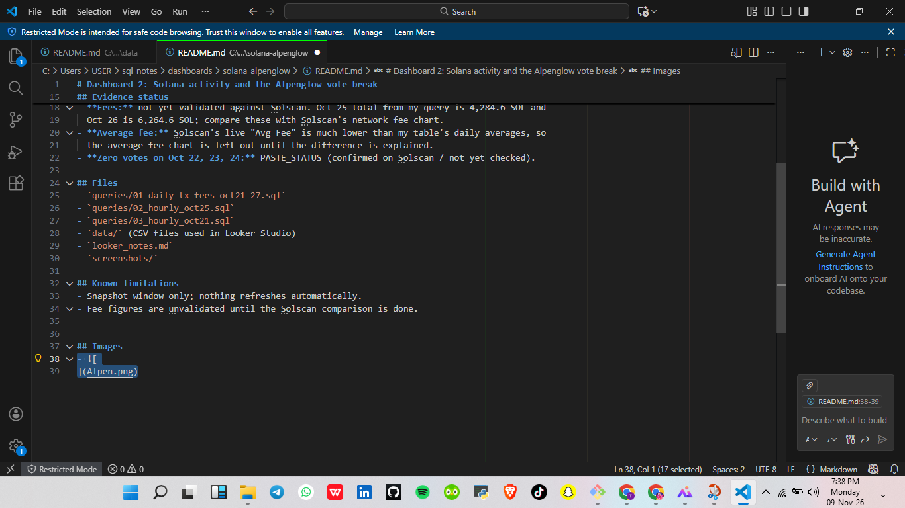

# Dashboard 2: Solana activity and the Alpenglow vote break

- [Solana activity and the Alpenglow vote break](dashboards/solana-alpenglow/): Looker Studio dashboard on BigQuery's public Solana data, with hourly evidence checked against Solscan.

Looker Studio dashboard on BigQuery's public Solana data.

- **Dashboard link:** https://datastudio.google.com/reporting/b3113f90-070c-4574-a427-cfe614312b19
- **Source table:** `bigquery-public-data.crypto_solana_mainnet_us.Transactions`
- **Date window:** 2026-10-21 to 2026-10-27 inclusive, UTC (hardcoded)
- **Status:** snapshot, not live

## What it shows
1. Daily transactions for Oct 21 to Oct 27
2. Hourly transactions for Oct 21, to locate where the count steps down
3. Solscan chart as independent evidence

## Evidence status
- **Step-down hour:** expected around 15:00 UTC on Oct 21. Actual hour from the hourly
  query: PASTE_HOUR (record it here even if it differs from 15:00).
- **Fees:** not yet validated against Solscan. Oct 25 total from my query is 4,284.6 SOL and
  Oct 26 is 6,264.6 SOL; compare these with Solscan's network fee chart.
- **Average fee:** Solscan's live "Avg Fee" is much lower than my table's daily averages, so
  the average-fee chart is left out until the difference is explained.
- **Zero votes on Oct 22, 23, 24:** Confirmed on Solscan (successful vote vs non-vote chart).

## Files
- `queries/01_daily_tx_fees_oct21_27.sql`
- `queries/02_hourly_oct25.sql`
- `queries/03_hourly_oct21.sql`
- `data/` (CSV files used in Looker Studio)
- `looker_notes.md`
- `screenshots/`

## Known limitations
- Snapshot window only; nothing refreshes automatically.
- Fee figures are unvalidated until the Solscan comparison is done.

## Images
- 
- 
- 