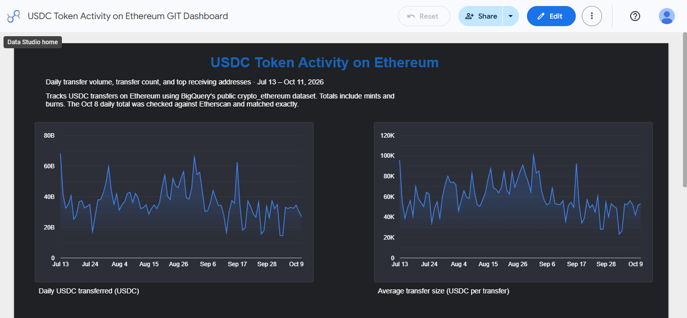
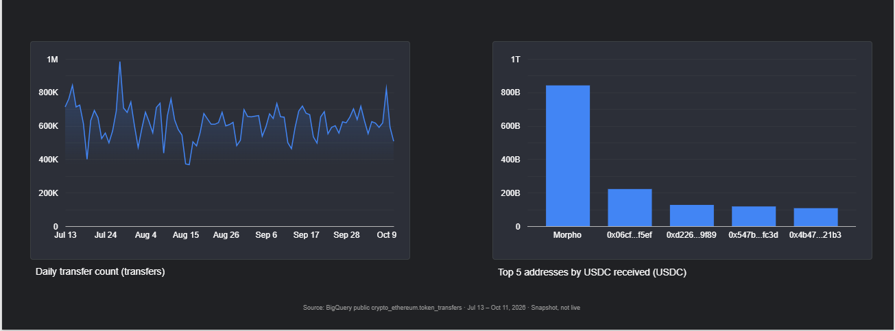

# Dashboard 1: USDC token activity (Ethereum)

Looker Studio dashboard on BigQuery's public `crypto_ethereum` dataset.

- **Dashboard link:** https://datastudio.google.com/reporting/12cd2d90-4b59-4f55-a3b4-73094f9a1d56
- **Source table:** `bigquery-public-data.crypto_ethereum.token_transfers`
- **Token:** USDC (`0xa0b86991c6218b36c1d19d4a2e9eb0ce3606eb48`)
- **Date window:** 2026-07-13 to 2026-10-11 inclusive (hardcoded)
- **Status:** snapshot, not live

## Validation
Daily total for 2026-10-08 matched Etherscan exactly. Morpho was verified on Etherscan and Circle wasn't among the top5.

## Charts
1. Daily USDC transferred (USDC)
2. Daily transfer count (transfers)
3. Top 5 addresses by USDC received (zero address excluded)
4. Average transfer size (USDC per transfer), a check on the claim that a few large
   transfers drive the biggest days

## Findings
USDC volume on Ethereum peaked at about 68B per day (Jul 13 and around Aug 29), and the average transfer size peaked on those same days at roughly 100K USDC, while the highest transfer count (about 1M, late July) came on a mid-volume day, so a few large transfers drove the biggest days rather than a surge in transfer count. Morpho was the top receiving address with roughly 840B USDC received between Jul 13 and Oct 11, 2026, about four times the next address.

## Files
- `queries/01_daily_usdc_transfers.sql`
- `queries/02_top_movers.sql`
- `looker_calculated_fields.md`
- `screenshots/` (add a PNG of the finished dashboard)

## Known limitations
- Totals include mints and burns.
- Snapshot window only; nothing refreshes automatically.

